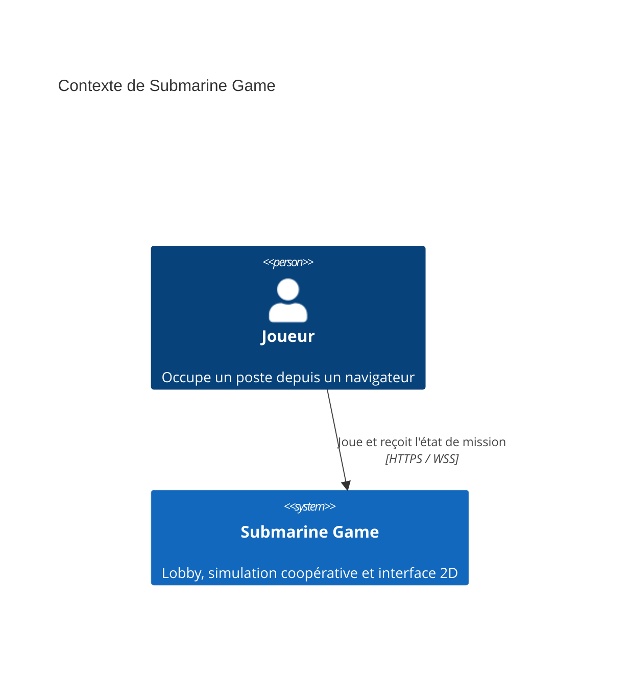
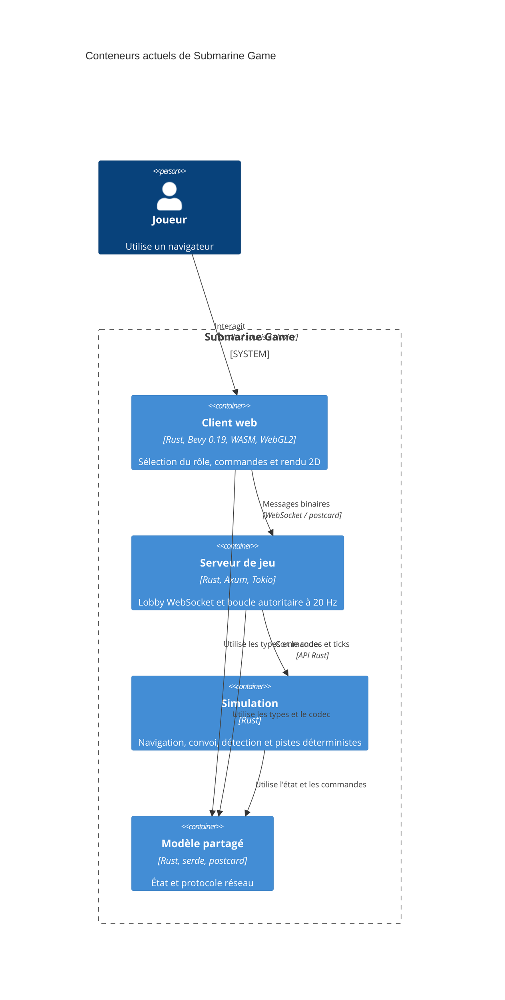
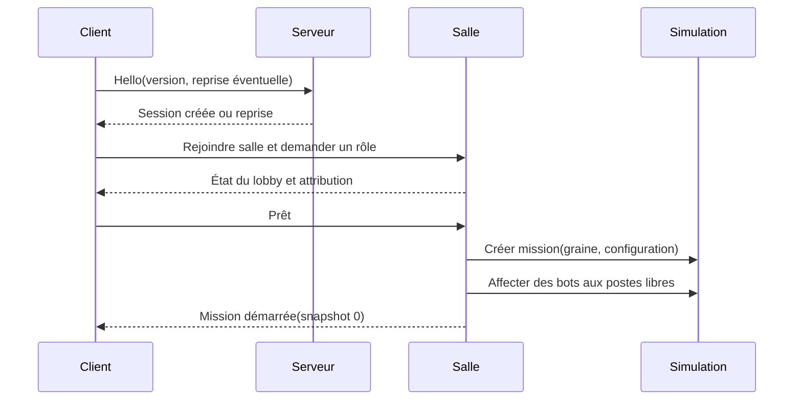
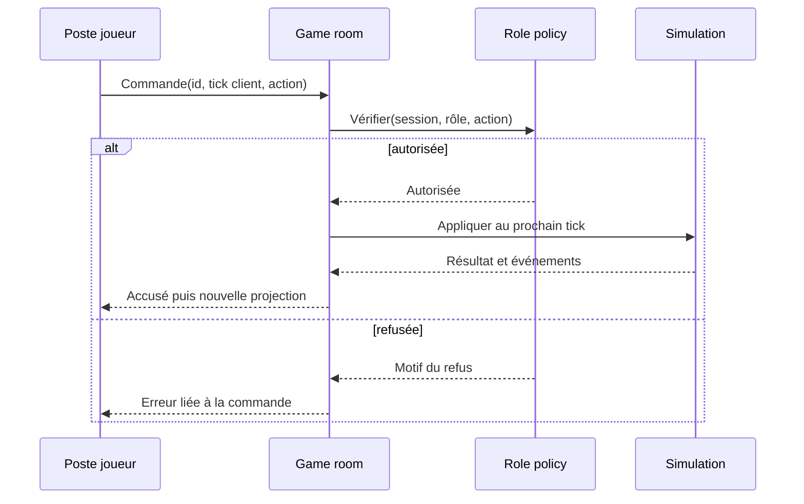
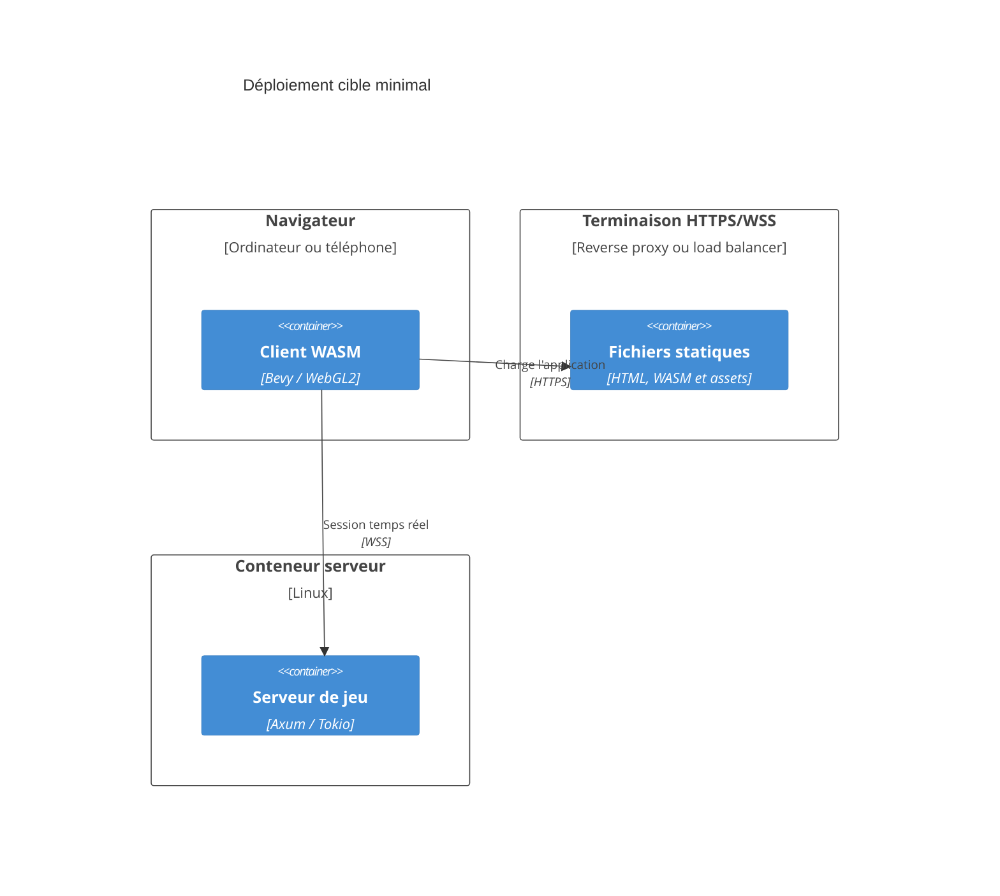

# Architecture de Submarine Game

**Version :** 0.1  
**Date :** 28 août 2026  
**Statut :** architecture actuelle documentée, architecture cible proposée

Ce document suit une structure arc42 allégée. Les éléments marqués **existant** décrivent le dépôt actuel. Les éléments marqués **cible** décrivent l'architecture nécessaire au jeu défini dans le [Game Design Document](game-design.md).

## 1. Introduction et objectifs

### 1.1 Objectif du système

Le système fournit une simulation tactique de sous-marin coopérative en temps réel. Des clients web spécialisés par poste envoient des commandes à un serveur autoritaire. Le serveur valide les responsabilités de chaque rôle, fait avancer une simulation déterministe et diffuse l'état observable aux joueurs.

### 1.2 Fonctionnalités principales

- Salle de jeu de un à cinq participants.
- Un poste distinct par joueur et bots pour les postes vacants.
- Simulation de navigation, détection, combat, ressources et avaries.
- Interface 2D compatible ordinateur et téléphone.
- Reconnexion à une partie en cours.
- Mission reproductible à partir d'une graine et d'une séquence de commandes.

### 1.3 Objectifs qualité

| Priorité | Objectif | Critère cible |
|---:|---|---|
| 1 | Jouabilité web et mobile | cinq postes utilisables au tactile à partir de 360 px de large |
| 2 | Cohérence de la partie | aucune règle décisive calculée uniquement par un client |
| 3 | Déterminisme | même graine et mêmes commandes produisent le même résultat |
| 4 | Résilience réseau | une déconnexion temporaire est remplacée par un bot puis reconnectable |
| 5 | Maintenabilité | règles testables sans Bevy, Axum, Tokio ni navigateur |
| 6 | Performance | simulation stable à 20 Hz pour une salle sur la cible serveur retenue |

### 1.4 Parties prenantes

| Partie prenante | Attentes |
|---|---|
| Joueur | interface lisible, commandes réactives, résultat explicable |
| Groupe de joueurs | lobby simple, rôles uniques, continuité malgré une déconnexion |
| Conception | paramètres d'équilibrage centralisés et scénarios reproductibles |
| Développement | frontières de crates claires et tests rapides |
| Exploitation | déploiement simple, métriques par salle et diagnostic des erreurs |

## 2. Contraintes

### 2.1 Contraintes techniques

| ID | Contrainte | Conséquence |
|---|---|---|
| CT-01 | Client Rust compilé en WebAssembly | APIs navigateur et ressources non `Send` à respecter |
| CT-02 | Rendu Bevy 0.19 compatible WebGL2 | éviter les fonctions uniquement WebGPU et les calculs GPU avancés |
| CT-03 | Client utilisable sur téléphone | budget visuel réduit, contrôles sans survol et UI responsive |
| CT-04 | WebSocket binaire `postcard` | protocole partagé compact mais à versionner explicitement |
| CT-05 | Serveur autoritaire | les clients soumettent des intentions, jamais un nouvel état |
| CT-06 | Simulation à 20 Hz | commandes séquentielles et règles indépendantes du framerate de rendu |
| CT-07 | `simulation` dépend uniquement de `shared` | aucune dépendance à Bevy, Axum, Tokio ou à l'état serveur |
| CT-08 | État horizontal et profondeur séparés | ne pas remplacer `x`, `y`, `depth` par un vecteur 3D générique |

### 2.2 Conventions

- Les messages réseau sont enveloppés dans `ClientMessage` et `ServerMessage`.
- Les grandeurs du domaine utilisent des unités documentées : mètres, secondes, degrés nautiques et nœuds.
- Les flottants non finis sont rejetés à la frontière de la simulation.
- Les valeurs d'équilibrage sont regroupées dans une configuration de mission ou de bâtiment.
- Les changements de protocole incompatibles augmentent sa version.
- Le français est la langue initiale de l'interface ; les identifiants de code restent en anglais.

## 3. Périmètre et contexte

### 3.1 Contexte métier

Le premier périmètre ne dépend d'aucun service externe métier. L'identité persistante, le matchmaking public, la télémétrie externe et le chat vocal ne sont pas requis.

### 3.2 Contexte technique

| Interface | Technologie actuelle | Responsabilité |
|---|---|---|
| Page du jeu | HTML + WASM + WebGL2 | charger le client Bevy |
| Session temps réel | WebSocket binaire | rejoindre le lobby, envoyer les commandes et recevoir les événements |
| Sérialisation | `serde` + `postcard` | encoder les enveloppes partagées |
| Serveur HTTP | Axum | exposer `/ws` et accepter l'upgrade WebSocket |
| Boucle de jeu | Tokio + canal `mpsc` | ordonner les commandes et avancer la simulation |

Le navigateur construit l'URL `ws://` ou `wss://` depuis l'origine. Lorsque Trunk sert la page sur le port de développement `8080`, il conserve le nom d'hôte et cible le serveur sur `3000` ; l'exécution native accepte `WS_URL`.

## 4. Stratégie de solution

### 4.1 Principes

1. Conserver le workspace en quatre crates tant qu'une nouvelle frontière n'est pas justifiée.
2. Faire de `simulation` la source unique des règles, de l'IA déterministe et des transitions d'état de mission.
3. Faire de `server` le propriétaire des connexions, salles, présences, permissions et cadences.
4. Limiter `shared` aux types de protocole et aux données légères partagées.
5. Faire de `client` une projection interactive de l'état observable, sans logique décisive.
6. Livrer par vertical slices, avec une mission jouable à chaque jalon majeur.

### 4.2 Architecture actuelle et cible

| Domaine | Existant | Cible |
|---|---|---|
| Lobby | registre en mémoire, codes courts, rôles uniques, prêts, démarrage explicite dès un joueur et bots | persistance et reprise éventuelles |
| Présence | retrait à la déconnexion | période de grâce, bot de remplacement et reprise de rôle |
| Navigation | consignes et valeurs réelles, inertie, plongée, ballasts, remontée d'urgence et dérive liée à l'inondation | assiette et stabilité |
| Sonar | convoi déterministe, observations passives/actives et pistes incertaines | propagation et classification enrichies |
| Armement | tubes temporisés, solution depuis piste partagée, autorisation, torpilles et dégâts privés | types d'armes et effets d'avaries enrichis |
| Ingénierie | endurance, compartiments, dégâts, pompage, isolation, incendies, pannes, interventions temporisées et bot d'avaries | distribution détaillée, équilibrage et ergonomie enrichie |
| IA | bots de poste minimaux ; escorte avec perception acoustique privée, recherche, attaque non guidée et retour au convoi | bots de poste complets et tactiques enrichies |
| Client | lobby, postes tactiles Pilote, Ingénierie, Sonar, carte et procédures Capitaine/Armement | interfaces mobiles finalisées et état de reconnexion |
| Protocole | version 7, identifiants opaques, projections par rôle, diagnostics d'armement, pings entendus et accusés de commandes | reprise et négociation de compatibilité |

## 5. Vue des blocs de construction

### 5.1 Conteneurs existants

Ce diagramme décrit uniquement les éléments réellement présents dans le dépôt.

### 5.2 Crate `shared`

**Existant :**

- `CrewRole`, `SystemId`, `SystemStatus` et `SubmarineState` ;
- enveloppes versionnées, identifiants de salle/session/joueur/commande et séparation lobby/mission ;
- état de lobby, configuration de mission, tick et snapshot numérotés ;
- observations Sonar, pistes opaques et projections tactiques par rôle ;
- `PlayerCommand`, `GameEvent` et erreurs liées aux commandes ;
- codec `postcard`.

**Cible :**

- identifiants opaques d'entité supplémentaires ;
- négociation de plusieurs versions et informations de compatibilité ;
- vues observables par rôle, sans exposer l'état secret de l'ennemi ;
- types d'erreur stables et affichables.

`shared` ne doit pas contenir de logique d'IA, de minuterie, de socket ni d'élément Bevy.

### 5.3 Crate `simulation`

**Existant :** navigation nautique inertielle, plongée et ballasts, propulsion diesel-électrique, batterie, oxygène, signature acoustique, alertes de seuil, convoi déterministe, détection passive/active, pistes incertaines et automatisation minimale des bots Ingénierie et Sonar. `weapons.rs` possède les tubes, autorisations, solutions calculées exclusivement depuis les estimations partagées et courses de torpilles. `world.rs` applique les collisions, l'intégrité et les manœuvres privées du convoi. `WeaponsConfig` centralise les paramètres d'équilibrage transmis avec la mission.

Les mesures d'armement sont projetées uniquement vers le Capitaine et l'Armement. Les événements d'explosion observée et de fin de course estimée sont limités au Capitaine, à l'Armement et au Sonar. Une collision hors portée d'écoute ne raccourcit pas la course estimée envoyée au client : son résultat réel ne traverse pas la frontière réseau. L'intégrité, l'identité et la position réelle des navires restent dans le monde privé.

Le protocole v5 a ajouté `WeaponsMeasurements::solution_errors`, aligné sur les tubes et les solutions. La simulation distingue les données de piste manquantes, une piste perdue/non partagée, l'absence d'interception et l'autonomie insuffisante. Une solution calculable hors secteur conserve sa direction et ses avertissements, mais interdit le lancement ; un tir hors secteur reçoit une erreur distincte. Ces diagnostics n'utilisent que la piste partagée et la configuration du tir, sans information ennemie cachée. Le client distingue sélection locale, configuration appliquée, état courant et résultat de la dernière commande.

Le protocole v6 ajoute `TubeMeasurements::loaded`, `WeaponsConfig::max_surface_impact_depth` et des refus explicites pour profondeur incompatible et autorisation portant sur des réglages périmés. Les vitesses égales sont désormais traitées par le calcul linéaire d'interception, sans erreur spéciale. Les consignes bot en attente restent privées à la simulation et passent par `ConfigureShot` après chargement. Les événements de lancement avec relèvement, d'explosion et de fin de course sont réservés à Capitaine/Armement/Sonar. Le client conserve les 64 derniers événements avec leur tick ; le poste Armement affiche les six derniers événements d'armement dans l'ordre chronologique, sans écrasement des événements reçus dans un même lot réseau.

M5.1 ajoute `enemy_ai.rs`, propriétaire privé des états escorte/suspicion/recherche/retour, des pistes vieillissantes et des points de recherche. Ce module ne reçoit jamais `SubmarineState` : seules les fonctions de perception dans `detection.rs` consultent l'état réel pour produire des observations bruitées. `world.rs` orchestre les capteurs, les décisions et les déplacements limités, connaît les positions amies du convoi et transforme les impacts audibles en alertes de zone, sans fournir l'origine du tir. Une escorte coulée est exclue des capteurs et des décisions.

L'ordre du tick est stable : mouvement/ressources/bruit du joueur, vieillissement de la mémoire ennemie, écoute et éventuel ping ennemi, décision et déplacement des navires, suivi Sonar joueur, puis torpilles/impacts et alertes. Une alerte d'impact est donc exploitée au tick suivant. Les erreurs de mesure dérivent de la graine et du tick, sans horloge murale.

Le protocole v7, incompatible v6, ajoute `MissionConfig::escort` (`EscortConfig`, données légères uniquement) et `GameEvent::SonarPingHeard { bearing, bearing_uncertainty }`. La réception d'une émission et la production d'un écho ennemi sont indépendantes. L'événement public ne contient ni identité, ni position exacte, ni succès de détection ; le serveur le filtre vers Capitaine/Sonar seulement. Les deux postes affichent les trois derniers pings depuis l'historique client borné à 64 événements. Aucun état de l'IA ni sa piste privée ne traverse le réseau ; aucune nouvelle commande joueur n'est introduite.

M5.2 étend `enemy_ai.rs` avec une passe d'attaque sur estimation figée, fraîcheur/précision minimales, stock et cadence. Le budget de recherche inclut les attaques. Les profondeurs de largage viennent de la doctrine, pas de l'état joueur. `depth_charges.rs` fait descendre des charges horizontalement fixes ; `Simulation` résout ensuite leurs effets avec la position réelle, sans renvoyer ce résultat à l'IA. Une escorte détruite ne largue plus, mais les charges existantes continuent. `damage.rs` possède les compartiments, les fuites, l'inondation, la destruction et un historique borné à 64 faits ; `SubmarineState::hull_integrity` reste la valeur de coque autoritaire. La dérive d'inondation s'ajoute à la dynamique verticale. La destruction fige la simulation hors ticks et bloque commandes et automatismes ; le cycle complet de fin de mission reste en M6.

Le protocole v8 est incompatible v7. `EscortConfig::attack` et `MissionConfig::damage` portent les réglages ; les types partagés restent des données légères. `CommonMeasurements::damage` transmet coque, inondation moyenne, destruction et dernière cause à tous les postes. `EngineeringMeasurements` ajoute les trois compartiments et l'historique complet borné : les avaries ne dépendent pas de l'arrivée d'un événement éphémère. Les alertes de coque, voie d'eau et destruction sont également répétées dans les snapshots. `ExplosionHeard` est une simple perception sonore diffusée aux cinq postes ; il ne porte aucune identité, coordonnée ou confirmation d'impact. Cette variante remplace le nom Rust `DepthChargeHeard` au même index `postcard` (9), sans modifier sa représentation binaire ni la version v8. Elle couvre les charges audibles et les impacts de torpille audibles ; les événements identifiés de torpille gardent leur filtrage propre. `SubmarineDamaged` et `SubmarineDestroyed` décrivent uniquement le sous-marin joueur et sont diffusés à tous. Le client affiche un bandeau de synthèse dans les postes plein écran, le détail dans le poste Ingénierie défilant et refuse avec un message explicite les commandes après destruction. Aucun détail de charge ou d'IA n'est projeté.

`explosion_ui.rs` affiche une alerte unique de trois secondes réelles, indépendante du tick serveur. Le compteur monotone de réceptions dans `GameState` permet de regrouper aussi les explosions simultanées et les rafales dépassant l'historique borné de 64 événements. Seul `ExplosionHeard` alimente ce compteur : un `TorpedoImpact` reçu en parallèle n'est pas compté deux fois. Le bandeau est non interactif (`Pickable::IGNORE`), placé en haut sur le statut et non sur les commandes, sans clignotement ni bouton de fermeture. Sa durée et son compteur sont réinitialisés hors partie ; les anciens événements ne redéclenchent pas l'alerte. Les snapshots d'avarie ne sont pas masqués par une modification de leur texte : l'alerte transitoire est séparée de l'état persistant.

Le même bandeau affiche en priorité `SOUS-MARIN PERDU` sur fond rouge dès que `CommonMeasurements::damage.destroyed` est vrai. Cette alerte n'expire pas, ne dépend pas de l'événement de destruction et reste visible après une déconnexion tant que le dernier snapshot indique la perte. Elle remplace les alertes d'explosion sans empilement et disparaît quand l'état de perte est effacé ou remplacé par un nouveau snapshot sain.

### M5.3 — Contrôle des avaries (26 octobre 2026)

`damage.rs` reste propriétaire des compartiments et ajoute les intentions de pompe/isolation, les défauts persistants et une seule intervention temporisée. Ses commandes valident indices, disponibilité de l'équipe, présence d'une avarie et sécurité du travail. Une intervention devenue dangereuse est suspendue ; une annulation abandonne sa progression. La propagation ne consulte que les compartiments adjacents du tick précédent ; l'isolation bloque les échanges sans supprimer la fuite. La coque n'est jamais régénérée par une intervention. `Simulation` intègre consommation/bruit des pompes, consommation d'air du feu, contraintes des systèmes et transitions `SystemDamaged`/`SystemRepaired`. L'absence d'événement ne masque pas une panne : l'état projeté est complet.

Le protocole **v9, incompatible v8**, ajoute les commandes `SetCompartmentPump`, `SetCompartmentIsolated`, `StartDamageControl`, `CancelDamageControl`, et rend `RepairSystem` réellement temporisé. Les champs légers de `DamageConfig` centralisent les réglages ; `CompartmentState` porte feu, isolation et demande de pompage. `EngineeringMeasurements::damage_control` expose l'intervention (cible/action/temps restant/durée/suspension) et la disponibilité des cinq systèmes. Seule l'Ingénierie reçoit ces détails ; `DamageSummary` expose aux autres postes feu moyen et nombre de systèmes indisponibles, avec alertes persistantes. Les refus de panne ou de procédure sont structurés. Le serveur conserve la validation des rôles avant toute mutation, et autorise les nouvelles commandes à l'Ingénierie uniquement.

L'Ingénierie bot produit des commandes identiques à celles du joueur, sans accélération ni réparation implicite. Elle isole les avaries, demande les pompes, privilégie extinction puis colmatage puis réparation, et rouvre après contrôle du feu/de l'eau/de la fuite. Elle ne modifie aucune consigne Pilote. `damage_control_ui.rs` fournit la sélection de compartiment et les boutons tactiles dans le panneau Ingénierie existant, défilant à la molette et au glissement ; le statut d'équipe, les compartiments et les systèmes proviennent toujours du serveur. La destruction reste terminale ; bilan et relance appartiennent à M6.

La projection d'Ingénierie distingue aussi les pannes persistantes (`faults`) d'une indisponibilité ambiante ou d'une isolation, pour rendre l'action de réparation compréhensible. `SonarMeasurements::operational` permet au poste Sonar d'afficher « SONAR HS » et de ne pas proposer un ping interdit, sans exposer les compartiments. Sur téléphone portrait, le HUD Pilote/Ingénierie a une hauteur bornée et son propre défilement ; ses refus apparaissent avant les autres mesures afin qu'une erreur ajoutée aux alertes ne recouvre pas les commandes de station.

**Composants cibles :**

| Composant | Responsabilité |
|---|---|
| Mission | phase, objectifs, temps, victoire et défaite |
| World | entités navales, torpilles et environnement tactique |
| Submarine | mouvement, ressources, compartiments et systèmes |
| Detection | signatures, observations, pistes et perte de contact |
| Weapons | tubes, solution de tir, trajectoires et impacts |
| Damage control | dégâts, propagation, pompage et réparations |
| Crew automation | bots de poste exécutant des ordres autorisés |
| Enemy AI | perception et états escorte, suspicion, recherche et attaque |
| Mission RNG | hasard déterministe dérivé de la graine de mission |

Les systèmes sont exécutés dans un ordre stable à chaque tick. Toute dépendance à l'heure murale ou à un générateur aléatoire global est interdite.

### 5.4 Crate `server`

**Existant :** route WebSocket, registre de salles en mémoire, attribution de rôles uniques, prêts, démarrage explicite, validation des commandes, projections du sous-marin et des pistes par rôle, et une tâche de simulation à 20 Hz par salle.

**Composants cibles :**

| Composant | Responsabilité |
|---|---|
| Room registry | créer, retrouver et détruire les salles |
| Session | authentifier une connexion éphémère et gérer sa reprise |
| Lobby | rôles, états prêts, paramètres et lancement |
| Game room | posséder une simulation et ordonner les commandes |
| Role policy | vérifier qu'une commande est permise pour le rôle actif |
| Projection | produire la vue observable de chaque rôle |
| Broadcaster | diffuser snapshots et événements avec backpressure contrôlée |

Une salle possède une seule file séquentielle de commandes. Un client lent ne doit pas bloquer le tick : les snapshots anciens peuvent être remplacés par le plus récent, tandis que les événements critiques doivent être conservés ou provoquer une resynchronisation.

### 5.5 Crate `client`

**Existant :** connexion `ewebsock` en ressource `NonSend`, URL dérivée de l'origine, création/rejoint de salle, sélection de rôle, lobby minimal, interpolation, postes tactiles Pilote, Ingénierie et Sonar, carte tactique Capitaine/Armement et ordre du capitaine au bot Pilote.

`weapons_ui.rs` ajoute les sélections de piste/tube, les réglages et procédures de préparation, l'ordre au bot Armement, l'autorisation du Capitaine et la confirmation distincte avant le tir. Les réponses `CommandAccepted { command_id }` et `Error { command_id, error }` sont envoyées uniquement à l'émetteur ; les snapshots confirment l'état effectif des tubes.

**Composants cibles :**

| Composant | Responsabilité |
|---|---|
| Connection | URL configurable, protocole, reprise et état de connexion |
| Session state | salle, joueur, rôle, tick reçu et droits disponibles |
| Command state | commande locale en attente, acceptée, exécutée ou rejetée |
| Station shell | navigation commune, alertes et adaptation responsive |
| Station views | capitaine, pilotage, sonar, ingénierie et armement |
| Tactical rendering | carte, pistes, incertitudes et entités observables |
| Accessibility | taille tactile, contraste, texte et réduction des animations |

Le client peut prédire un retour d'interface, mais ne prédit pas les contacts, impacts, dégâts ou ressources autoritaires.

## 6. Vue d'exécution

### 6.1 Connexion et démarrage cible

### 6.2 Traitement d'une commande

### 6.3 Déconnexion et bot de remplacement

1. Le serveur marque la session comme déconnectée sans libérer immédiatement son rôle.
2. Le rôle passe sous contrôle d'un bot à partir d'un tick défini.
3. Le bot conserve les ordres actifs compatibles.
4. Le client revient avec son jeton de reprise et son dernier numéro de snapshot.
5. Le serveur renvoie un snapshot complet puis rend le rôle au joueur sur une frontière de tick.
6. À expiration de la période de grâce, la place peut être libérée selon les règles de la salle.

### 6.4 Production d'une piste sonar

1. `Detection` calcule les signatures réellement audibles par le sous-marin.
2. Le poste sonar reçoit des observations, pas les entités ennemies.
3. Le joueur ou le bot associe une observation à une piste.
4. La simulation met à jour confiance et incertitude.
5. Une piste partagée entre dans les projections du capitaine et de l'armement.
6. La perte d'observation fait dériver puis expirer la piste.

## 7. Déploiement

### 7.1 Développement actuel

- serveur Axum sur `0.0.0.0:3000` ;
- client Trunk sur `127.0.0.1:8080` ;
- WebSocket dérivé de l'hôte de la page (`:3000` avec Trunk en développement) ;
- aucun stockage persistant requis.

### 7.2 Cible de production

La première cible peut rester un processus serveur unique. Une salle n'est pas distribuée entre plusieurs processus. Avant une mise à l'échelle horizontale, le routage doit garantir qu'une connexion revient vers le processus propriétaire de sa salle.

## 8. Concepts transverses

### 8.1 Autorité et information cachée

L'état interne complet reste dans `simulation`. Le serveur construit une projection par rôle. Un client sonar ne reçoit pas la position réelle d'un ennemi caché ; il reçoit uniquement les observations et pistes auxquelles son rôle a droit. Cette règle empêche la triche triviale et préserve la mécanique d'information incomplète.

### 8.2 Déterminisme

- pas de lecture directe de l'horloge dans les règles ;
- `dt` fixe contrôlé par la boucle ;
- ordre d'itération stable des entités ;
- générateur pseudo-aléatoire possédé par la mission ;
- commandes indexées par tick et ordonnées de façon stable ;
- tests de rejeu à partir d'une graine et d'un journal de commandes.

Le déterminisme bit à bit entre architectures n'est pas supposé tant que les calculs reposent sur `f32`. Le premier objectif est la reproductibilité sur la même cible. Si un rejeu portable devient nécessaire, les règles sensibles devront utiliser des nombres fixes ou une quantification explicite.

### 8.3 Protocole et compatibilité

Le protocole cible commence par une négociation de version. Les messages de partie incluent un identifiant de salle et un numéro de séquence ou de tick. Une modification incompatible de l'ordre ou de la forme des variantes `postcard` nécessite une nouvelle version ; ajouter une variante au milieu d'un enum existant est interdit sans migration contrôlée.

### 8.4 Backpressure

- Les commandes entrantes ont une capacité bornée et un refus explicite en cas de surcharge.
- Un nouveau snapshot peut remplacer un snapshot non envoyé plus ancien.
- Les événements critiques sont numérotés et confirmés par le prochain snapshot complet.
- Un client durablement lent est déconnecté avec une cause exploitable.

### 8.5 Sécurité

- HTTPS et WSS obligatoires en production.
- Jetons de salle non prédictibles et limités à une session.
- Validation de taille avant décodage d'une trame.
- Limitation du débit de connexion et de commandes.
- Validation du rôle et des paramètres pour chaque commande.
- Aucun secret ni état ennemi complet envoyé au client.

### 8.6 Observabilité

Les journaux structurés incluent au minimum `room_id`, `session_id`, `tick`, type de commande et motif de rejet. Les métriques couvrent nombre de salles, joueurs connectés, durée des ticks, taille des files, trames rejetées et reconnexions.

### 8.7 Tests

| Niveau | Cible |
|---|---|
| Unitaire | formules, transitions et permissions de chaque système |
| Propriété | bornes physiques, absence de valeurs non finies et invariants de ressources |
| Rejeu | même graine et même journal donnent le même état final |
| Intégration | lobby, démarrage avec bots, déconnexion et reprise |
| Protocole | aller-retour codec et compatibilité des fixtures versionnées |
| Client WASM | compilation WebGL2 et logique d'interface testable sans rendu complet |
| E2E | une mission courte jouée par clients automatisés contre un serveur réel |

## 9. Décisions d'architecture

| ID | Décision | Statut |
|---|---|---|
| AD-001 | serveur autoritaire et commandes comme intentions | acceptée, existante |
| AD-002 | simulation indépendante de Bevy, Axum et Tokio | acceptée, existante |
| AD-003 | client web Rust/Bevy avec cible WebGL2 | acceptée, existante |
| AD-004 | profondeur séparée des coordonnées horizontales | acceptée, existante |
| AD-005 | conserver cinq rôles et automatiser les postes vacants | proposée |
| AD-006 | IA et hasard de mission déterministes dans `simulation` | proposée |
| AD-007 | projections d'état différentes selon les rôles | proposée |
| AD-008 | protocole versionné avec reprise par snapshot complet | proposée |
| AD-009 | un processus propriétaire par salle | proposée |

Les décisions proposées doivent être transformées en ADR séparés lorsqu'un choix concurrent sérieux apparaît ou avant leur première implémentation structurante.

## 10. Exigences qualité

| ID | Scénario | Cible |
|---|---|---|
| Q-01 | un joueur touche une commande | retour local immédiat et résultat serveur visible sans ambiguïté |
| Q-02 | le réseau est interrompu pendant 20 secondes | le bot reprend le rôle et le joueur retrouve la partie |
| Q-03 | cinq joueurs envoient des commandes simultanées | ordre stable, aucune mutation concurrente de la simulation |
| Q-04 | le client reçoit un snapshot ancien | il l'ignore sans revenir dans le temps |
| Q-05 | un téléphone passe du portrait au paysage | interface reconstruite sans perdre session ni état de commande |
| Q-06 | un développeur ajoute un type de navire | pas de dépendance nouvelle dans `shared` ou `client` vers le serveur |
| Q-07 | un joueur inspecte les messages réseau | aucune position exacte d'un contact non observé n'est présente |
| Q-08 | la durée d'un tick augmente | métrique et journal identifient la salle concernée |

## 11. Risques et dette technique

| ID | Risque ou dette | Impact | Traitement |
|---|---|---|---|
| R-01 | portée de simulation trop large avant une mission jouable | élevé | vertical slices et règles minimales par système |
| R-02 | interface dense sur petit téléphone | élevé | prototypes tactiles avant chaque mécanique profonde |
| R-03 | calculs `f32` non reproductibles entre cibles | moyen | quantification ou nombres fixes si les rejeux inter-cibles l'exigent |
| R-04 | surcharge réseau par snapshots complets | moyen | mesurer d'abord, puis projections compactes et snapshots remplaçables |
| R-05 | IA ennemie utilisant accidentellement l'état omniscient | élevé | API de perception dédiée et tests de visibilité |
| TD-01 | URL WebSocket locale codée en dur | résolu en M1 | URL dérivée de l'origine et configuration native `WS_URL` |
| TD-02 | lobby global et démarrage à cinq joueurs | résolu en M1 | registre en mémoire, prêts, démarrage explicite et bots |
| TD-03 | protocole non versionné | résolu en M1, évolué en M2 | version 2 et fixtures exactes `postcard` |
| TD-04 | riposte, dégâts et contrôle des avaries livrés en M5.1–M5.3 | recette et équilibrage à confirmer | valider la boucle de survie puis M6 |
| TD-05 | PWA annoncée mais non configurée | attente incorrecte | ajouter manifeste/service worker ou corriger la promesse |

## 12. Glossaire

| Terme | Définition |
|---|---|
| Commande | intention envoyée par un joueur ou un bot à la simulation |
| Événement | fait produit par une transition de simulation |
| Observation | mesure ponctuelle et imparfaite d'une signature |
| Piste | estimation persistante construite à partir d'observations |
| Projection | sous-ensemble de l'état autorisé et utile pour un rôle |
| Snapshot | représentation complète d'une projection à un tick donné |
| Tick | pas fixe d'avancement de la simulation |
| Vertical slice | incrément traversant règles, serveur, protocole et interface pour être jouable |
| Reprise | reconnexion d'une session à sa salle et son rôle précédents |
| Signature | information physique susceptible d'être détectée, notamment le bruit |
